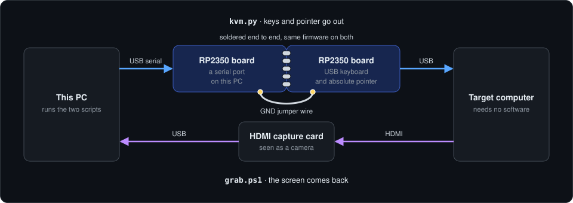
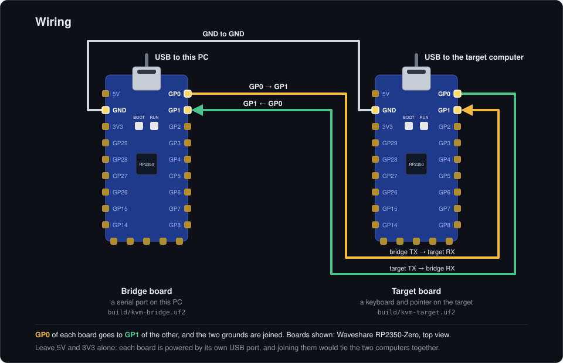
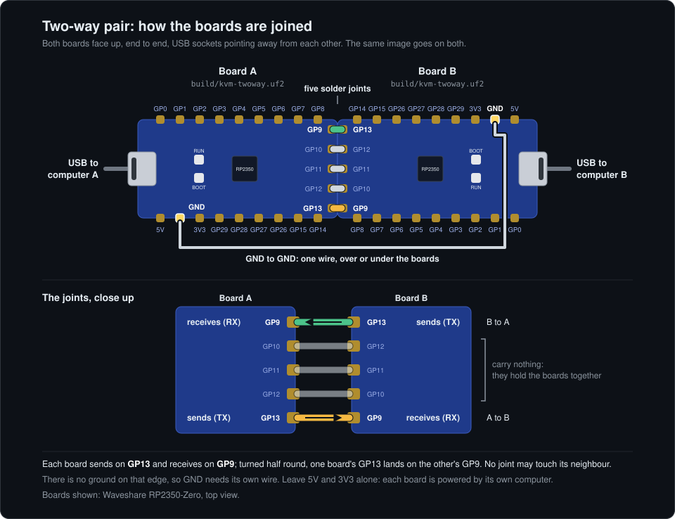
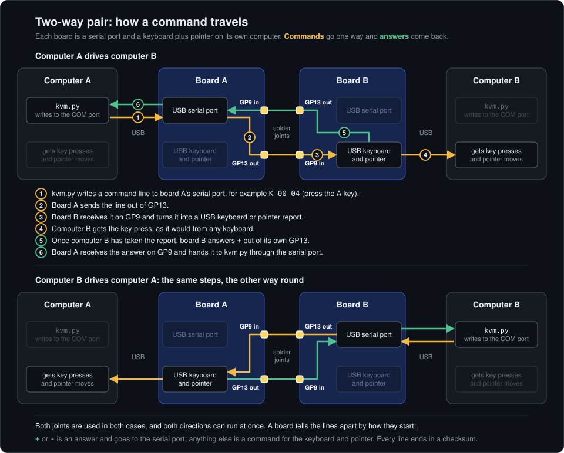
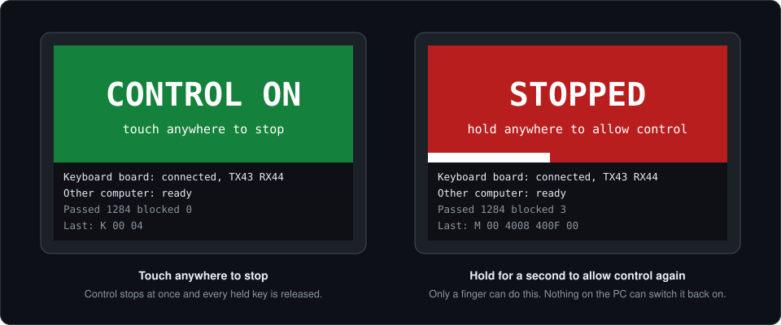
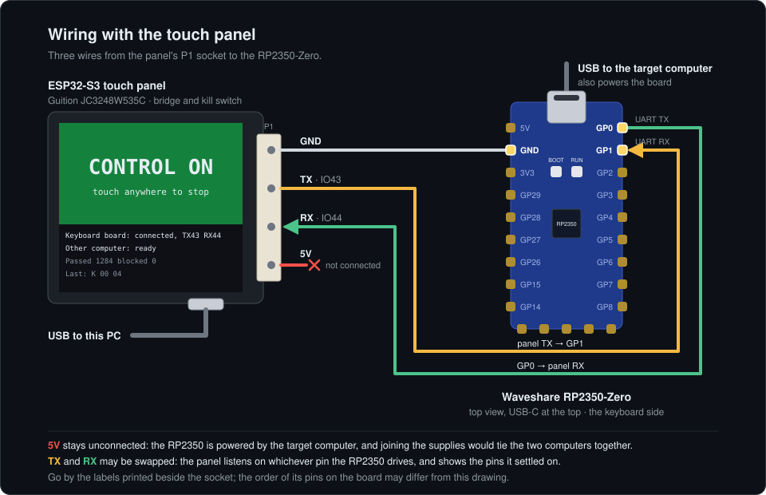

# kvm-link

Lets one PC be the keyboard, mouse and eyes of another computer, so the other one can be
set up, installed and driven without anyone sitting at it.



- **Bridge board**: an RP2350 running `firmware/kvm_bridge`. It is a USB serial port on this
  PC and passes commands on over three wires.
- **Target board**: a second RP2350 running `firmware/kvm_target`. The target computer sees
  a plain USB keyboard and an absolute pointer. No drivers; it works in firmware setup and
  boot menus as well as in an operating system.
- **Screen**: any HDMI capture card that Windows sees as a camera. `grab.ps1` saves a still
  from it.

`kvm.py` sends the input and `grab.ps1` gets the picture. Together they are enough to drive
firmware setup, boot menus, installers and a desktop from here.

Three more things are in here:

- `firmware/kvm_twoway` is one image for both RP2350 boards, with the wires on the end of
  the board, which lets either computer drive the other: see
  [Either way round](#either-way-round-the-same-firmware-on-both-boards).
- An ESP32 touchscreen panel can take the place of the bridge board and adds a **kill
  switch** that only a finger can turn back on: see
  [With a kill switch](#with-a-kill-switch-an-esp32-touch-panel-as-the-bridge).
- `skill/` holds a Claude skill that teaches Claude to use the pair: see
  [Claude skill](#claude-skill).

## Wiring



Three wires between the two boards:

| Bridge board | Target board |
|--------------|--------------|
| GP0 (TX)     | GP1 (RX)     |
| GP1 (RX)     | GP0 (TX)     |
| GND          | GND          |

Leave the 5V and 3V3 pads alone. Each board is powered by its own USB port, and joining the
supplies would tie the two computers together.

The picture shows the Waveshare RP2350-Zero. On a Raspberry Pi Pico 2 the same three are
pins 1 (GP0), 2 (GP1) and 3 (GND).

## Flash

Hold **BOOT** while plugging a board in and it appears as a drive named `RP2350`. Copy one
file to it:

| Board | File |
|-------|------|
| Bridge board, on this PC | `build\kvm-bridge.uf2` |
| Target board, on the target computer | `build\kvm-target.uf2` |

The files in `build\` are for the RP2350-Zero. `.\build.ps1` rebuilds them, and
`.\build.ps1 -Board rpipico2` builds for a Pico 2. The target board has no serial port once
flashed, so reflashing it always needs the BOOT button.

> **What has been run on real hardware.** The target board, `kvm.py` and `grab.ps1` have
> done real work, including an operating system install, but with the touch panel below as
> the bridge. The plain RP2350 bridge firmware builds and is a much simpler program, but it
> has not been run on a board yet. `kvm-twoway.uf2` has run on two RP2350-Zero boards
> soldered end to end, both plugged into one Windows PC: each is picked up as a serial
> port, keyboard and mouse, and in both directions `status` answers (1000 round trips
> without a failure), pointer moves land on the pixel asked for, a key press arrives, and
> `name` renames the far board and `--reset` undoes it. It has not met a firmware setup
> screen yet, clicks, typing, wheel and wake have not been tried on it, and nor has a name
> surviving a power cut. `name` was added to the target firmware after the work above and
> has not been run there, so the `kvm-target.uf2` here is firmware v2, a newer build than
> the one that was tested.

## Keyboard and mouse

```
python kvm.py status
python kvm.py type "ipconfig /all" --enter
python kvm.py key ctrl+alt+del
python kvm.py key down down enter
python kvm.py mash del --seconds 15      # tap a key through a reboot to reach setup
python kvm.py click 960 540
python kvm.py click 960 540 --double
python kvm.py --res 1280x720 click 640 360 --button right
python kvm.py drag 400 300 800 300
python kvm.py scroll -3
python kvm.py release
python kvm.py name "Bench keyboard"      # what the target computer is told it is called
```

Coordinates are pixels on the target's screen, in a frame whose size is given by `--res` or
the `KVM_RES` environment variable (default 1920x1080). The pointer is absolute, so the
frame does not have to be the target's real resolution: it only has to match the picture
the coordinates were read from. The serial port is found automatically, whichever kind of
bridge it is; `--port COM7` or `KVM_PORT` overrides.

Typing assumes a US keyboard layout on the target. Held keys are released if this PC stops
talking for five seconds. Only one program can have the bridge's serial port open at a time.

`name` sets the USB device name the target board gives the target computer, in place of
"kvm-link keyboard and pointer". It can be 32 plain ASCII characters at most. The board
stores it, so it is still called that after a power cut or a reflash, and it leaves the USB
bus for a second or two to announce it. `python kvm.py name` shows the current name,
`python kvm.py name --reset` goes back to the built-in one, and `status` shows it too.
On Windows the new name shows at once in Device Manager (Details, "Bus reported device
description"); the serial port of a two-way board keeps its own name, "TinyUSB Serial".
Settings may go on showing the name the device had when Windows first saw it, until the
device is removed there and plugged in again.

A script can import it instead of starting a process per action:

```python
import kvm
link = kvm.Link()                 # or kvm.Link("COM7")
k = kvm.Kvm(link, 1920, 1080)
k.click(960, 540); k.type("hello"); k.tap(0, [kvm.KEYS["enter"]])
k.set_name("Bench keyboard")      # k.set_name(None) for the built-in name
link.close()
```

`kvm.NoTarget` is raised when the target board does not answer and `kvm.Killed` when a
panel's kill switch is off; both are kinds of `kvm.KvmError`.

## Screen

```
.\grab.ps1 -List                                   # the camera names Windows knows
.\grab.ps1 -Device Elgato -Width 1920 -Out C:\temp\target.jpg
.\grab.ps1 -Device Elgato -Width 1920 -Crop 1500,0,420,120 -Out C:\temp\corner.jpg
```

`grab.ps1` uses the camera API built into Windows, so it needs no ffmpeg. `-Width 1920`
scales the still to 1920 wide, so that a point in the picture is the point to give
`kvm.py click`. `-Crop x,y,w,h` keeps one rectangle of that frame for a closer look.
`-WarmupMs` is how long it waits for the card to deliver a real frame (default 1500; 400 is
enough for a card that was used a moment ago).

Many capture cards ask the source for their largest mode, so a target may switch to
3840x2160 while its HDMI output is on the card, and its own panel shows nothing meanwhile.

## Either way round: the same firmware on both boards

`build\kvm-twoway.uf2` (`firmware/kvm_twoway`) goes on **both** RP2350 boards. Each board is
then a serial port *and* a keyboard and pointer on the computer it is plugged into, so it
does not matter which board goes to which computer, and `kvm.py` works from either one.

The link is on the short edge opposite the USB socket, and the two boards can be soldered
together there, end to end, both face up with their USB sockets pointing away from each
other. Each of the five pads of one edge is soldered to the pad it meets, five separate
joints:



| One board  | The other  |
|------------|------------|
| GP13 (TX)  | GP9 (RX)   |
| GP9 (RX)   | GP13 (TX)  |
| GND        | GND        |

- The two corner joints are the link: each board's GP13 to the other's GP9. The three
  joints between them carry nothing and only hold the boards together.
- No joint may touch its neighbour.
- **There is no ground on that edge**, and the link needs one. GND is the second pad down
  on the left side of each board; join the two with a wire.
- Turned half round is the only way that fits. With one board face down, GP13 would meet
  GP13 and the two outputs would fight each other.
- With wires instead of solder it is three wires: GP13 of each board to GP9 of the other,
  and GND to GND.

A command written to one board's serial port comes out of the other board as key presses
and pointer moves, and the answer comes back the same way:



Things that differ from the bridge and target pair:

- **It works in both directions at once.** A program on the target computer that opens the
  board's serial port can type and click on this PC, exactly as this PC can on the target.
  Use the one-way pair, or the panel below, when the target is not a machine you trust.
- **The target sees a serial port next to the keyboard**, where `kvm-target.uf2` shows a
  keyboard and pointer and nothing else. An operating system does not mind. A firmware
  setup screen or boot menu that ignores this keyboard needs `kvm-target.uf2` on that side.
- A board running it can be put into flashing mode without the BOOT button, by opening its
  serial port at 1200 baud and closing it again.

## With a kill switch: an ESP32 touch panel as the bridge

An ESP32-S3 touchscreen panel (Guition JC3248W535C, 3.5") running
`firmware/kvm_bridge_esp32` can stand in for the bridge board. It does the same job, and its
screen is a switch that software on the PC cannot override. Worth having when the thing
at the keyboard is a script or an AI agent. Nothing else changes: the target board, `kvm.py`
and `grab.ps1` are the same.



- **Touch the screen anywhere** while it is green ("CONTROL ON"): control stops at once and
  every held key and button is released.
- **Hold a finger on it for a second** while it is red ("STOPPED") to allow control again.

Nothing on the PC can switch it back on. The setting survives a reset or power cut, and a
panel that has never been set up starts STOPPED. Reading status is still allowed while
stopped; everything else is refused.

The lower part of the screen shows whether the target board is answering, whether the
target computer has picked it up, how many commands were passed and blocked, and the last
command sent.

### Wiring the panel



Three wires, from the panel's 4-pin power/UART socket (**P1**, next to the USB-C port,
labelled 5V / TX / RX / GND) to the target board. This is the arrangement in use and tested:

| JC3248W535C (P1) | Target board |
|------------------|--------------|
| TX (IO43)        | GP1 (RX)     |
| RX (IO44)        | GP0 (TX)     |
| GND              | GND          |

- Leave the socket's 5V pin unconnected, for the same reason as above.
- The panel finds the wires by itself. It also looks on the IO17/IO18 socket (P3/P4), and it
  does not matter which way round TX and RX are: it listens on whichever pin the target
  board is driving. The pins it settled on are shown in the first status line on the screen
  and by `python kvm.py status`.

On an Elecrow CrowPanel Advance 7.0 (`-Env crow70`) the link is the UART1-OUT port instead:
TX (IO20) to GP1, RX (IO19) to GP0, GND to GND, with the function switch on the back at
**0 1**.

### Flashing the panel

Over its USB port:

```
.\flash-bridge.ps1
```

The very first time, the panel's factory firmware ignores the request to enter flashing
mode: hold **BOOT**, tap **RST**, release BOOT, then run the script. After that it updates
without touching the buttons. `-Env crow70` selects another panel; apart from the
JC3248W535C none has been run on real hardware, and apart from the CrowPanel their link pins
are not verified.

## If it does not work

- **"no bridge board found"**: the bridge is not showing up as a serial port on this PC. Try
  another USB cable (many are charge-only); on a panel, also its other USB/UART socket.
- **"is in use by another program"**: something else has the bridge's serial port open,
  usually a script that is still running.
- **"the target board is not answering"**: a signal wire is loose or on the wrong pin, or
  the target board has no power from the target computer. A panel says "no answer" on its
  screen; with the port closed, sending `!probe` to its serial port lists every socket pin
  and marks the one the target board is driving as `high`.
- **"has not picked it up as a USB device"**: the target computer is off, or the cable to it
  carries power only.
- **"control is switched off at the touchscreen"** (panel only): hold a finger on the screen
  for a second.
- **`grab.ps1` saves a black picture**: the target is off or asleep (`python kvm.py wake`),
  or the card needs a longer `-WarmupMs`.

## Rebuild

`.\build.ps1` needs Arduino IDE 2 with the "Raspberry Pi Pico/RP2040/RP2350" board package
(earlephilhower). The ESP32 firmware needs PlatformIO (`pip install platformio`), and
`kvm.py` needs `pyserial`.

## Claude skill

`skill\kvm-link\SKILL.md` teaches Claude Code how to work a computer through this: check
the link, look at the screen, act, look again, and leave the kill switch to a person.

```
.\install-skill.ps1
```

copies it to `%USERPROFILE%\.claude\skills\kvm-link` together with `kvm.py` and `grab.ps1`,
so the skill works from any project. Run it again after changing any of the three.
